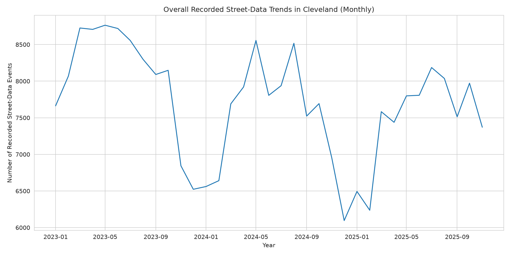

## 🔥 Interactive Crime Hotspot Map

👉 **Live map:**  
https://sochiencode.github.io/crime-trend-analysis-cleveland/

The map visualises visually observed concentrations of recorded events in Cleveland (UK)
using the existing Folium HeatMap method and open street-crime data.
The map covers January 2023–November 2025; it excludes outcome and stop-and-search records.
The 269,438 street-data records include 50,402 anti-social-behaviour records; they are not all criminal offences.
The heatmap shows recorded-event concentrations, not population-adjusted risk or exact incident locations. Its appearance depends on smoothing and zoom.


---

## Run the analysis

Use Python 3.12 (tested with 3.12.14). Run these commands from the repository root:

```bash
python -m venv .venv
source .venv/bin/activate
python -m pip install -r requirements.txt
jupyter lab crime_trends_analysis.ipynb
```

In Jupyter, restart the kernel and run all cells. For a fresh-kernel, noninteractive run that stops at the first error:

```bash
jupyter nbconvert --to notebook --execute --inplace crime_trends_analysis.ipynb --ExecutePreprocessor.timeout=180
```

The notebook regenerates `assets/monthly_trends.png`, `data/monthly_crime_trends_uk.csv`, `cleveland_crime_hotspots.html`, and `docs/index.html`.
The CSV retains its original filename for compatibility; its counts describe Cleveland, not the whole UK.
The bundled data contains 35 consecutive months, January 2023–November 2025. Street crime, outcomes, and stop-and-search remain separate files; only `*-street.csv` is loaded here. No Google Colab or external data download is required. Map tiles and JavaScript assets need internet access when viewing the HTML.

The missing-file experiments were removed because they referenced CSVs absent from this repository. The local-area analysis now defines its Cleveland street-crime table before use. Package installation is handled by `requirements.txt` rather than notebook cells. Monthly aggregation, seasonal averages, and heatmap settings are retained; this repair introduces no new crime findings. Power BI is optional and its dashboard file is not included.

## Key Analyses

### 1. Temporal Crime Trends
- Monthly aggregation of street-data records, including anti-social behaviour
- Descriptive seasonal comparisons and trends over the observed 35-month period
- Comparison across crime categories

📈 *Example output:*  


---

### 2. Crime Type Distribution
- Frequency analysis of reported crime types
- Identification of dominant offences across the period
- Comparison of variability between crime categories

---

### 3. Spatial Analysis
- Geographic plotting using latitude and longitude
- Folium heatmap to visualise concentrations of recorded street-data events
- Visual separation of dense vs low-frequency areas


---

### 4. Power BI Dashboard
The Power BI dashboard file is not included in this repository and is unavailable for verification. The notebook exports monthly counts suitable for use in Power BI; dashboard filters and interactions cannot be checked here.

---

## Key Insights (Summary)
- Certain crime categories consistently dominate monthly totals
- Clear temporal patterns are observable across the period
- The heatmap shows visually observed concentrations of recorded events; no statistical clustering test was performed
- The interactive map allows visual exploration of the recorded locations

*(Descriptive plots are available in the notebook; the dashboard is unavailable for verification.)*

---

## Limitations
- Analysis is limited to police-recorded street-data events, including anti-social behaviour
- No demographic or socioeconomic variables included
- Spatial accuracy depends on available coordinate precision
- No forecasting was performed
- The overall seasonal chart averages month/category counts, not monthly totals: “Average monthly records per crime category”
- Seasonal coverage is uneven: December has two monthly observations (2023 and 2024), while each other calendar month has three (2023–2025)
- The heatmap shows recorded-event concentrations, not population-adjusted risk or exact incident locations; no statistical clustering test was performed

---

## Future Improvements
- Add short-term crime forecasting models
- Introduce intervention scenario modelling (e.g. patrol increases)
- Enrich data with population or deprivation indices
- Publish dashboard to Power BI Service for public access

---

## Author
**Anamum Ifesochi**  
Data Analyst | Crime & Intelligence Analysis  
📍 UK

---

## License
This project is for **educational and portfolio purposes only**.  
Data remains the property of its original source.


## Streamlit portfolio dashboard

The dashboard provides category/date filters, monthly charts, matching-month year comparisons, downloadable counts and an aggregated geographic view. It explicitly separates anti-social behaviour and documents interpretation limits.

```bash
python -m pip install -r requirements-dashboard.txt
python -m streamlit run app.py
```

Geographic data is precomputed in `data/dashboard_geography.csv`. Regenerate it with `python scripts/prepare_dashboard_data.py`; this also reconciles all monthly counts against the committed export. The dashboard seasonal chart averages monthly totals, unlike the notebook's per-category chart. Geographic coordinates are rounded to two decimal places for visual bins, not exact incident locations.

For Streamlit Community Cloud, select this repository, `main` after merging, and `app.py`. The root requirements.txt includes dashboard dependencies; requirements-dashboard.txt supports a smaller local dashboard installation. Public deployment is a separate step.
